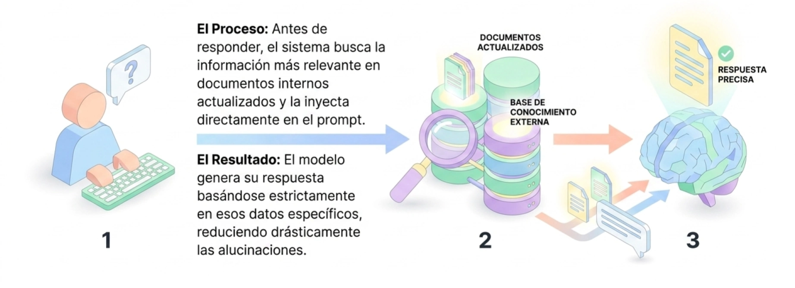

## 📚 **Retrieval-Augmented Generation**

La Generación Aumentada por Recuperación, conocida como **RAG** (por sus siglas en inglés, *Retrieval-Augmented Generation*), es una técnica arquitectónica que permite a los Modelos de Lenguaje Extensos (LLM) acceder a datos externos y actualizados que no formaban parte de su entrenamiento original. En términos sencillos, el RAG actúa como una "memoria externa" o un sistema de consulta a libro abierto para la IA, permitiéndole responder preguntas sobre documentos específicos, normativas internas o información de tiempo real. Su propósito fundamental es reducir las "alucinaciones" (respuestas falsas pero convincentes) y proporcionar respuestas factualmente precisas que el usuario pueda verificar mediante la citación de fuentes.

<center>
<figure>

<figcaption>RAG combina un LLM con una base de conocimiento externa.</figcaption>
</figure>
</center>

Para implementar un sistema RAG de manera efectiva, es necesario construir dos procesos o flujos de trabajo principales: la **etapa de indexación** y la **etapa de generación**.

### Etapa de Indexación 
**(Preparación del Conocimiento)**

Este es un proceso previo (generalmente fuera de línea) donde se prepara la base de conocimientos para que pueda ser consultada rápidamente. Consta de los siguientes componentes técnicos:
*   **Carga de datos (*Loading*):** Se conectan las fuentes originales de información, como archivos PDF, sitios web institucionales, bases de datos SQL o nubes de almacenamiento.

*   **División de texto (*Chunking*):** Los documentos largos se fragmentan en piezas más pequeñas y manejables llamadas "chunks", asegurando que la información importante no se pierda en contextos demasiado extensos.

*   **Conversión a vectores (*Embeddings*):** Cada fragmento de texto se transforma en una representación numérica llamada "embedding", la cual captura el significado semántico del contenido en un espacio de múltiples dimensiones.

*   **Almacenamiento (*Storage*):** Estos vectores se guardan en una **base de datos vectorial**, diseñada específicamente para realizar búsquedas por similitud de significado en lugar de simples palabras clave.

### Etapa de Generación 
**(Interacción en Tiempo Real)**

Este flujo ocurre cada vez que un usuario interactúa con el sistema para realizar una consulta:
*   **Recuperación (*Retrieval*):** Cuando el usuario hace una pregunta, el sistema convierte esa consulta en un vector y busca en la base de datos vectorial los fragmentos de información más parecidos o relevantes.

*   **Aumentación (*Augmentation*):** Los fragmentos recuperados se combinan con la pregunta original del usuario para crear un "promp extendido" que incluye el contexto necesario para responder.
*   **Generación (*Generation*):** Finalmente, el LLM recibe este paquete de información (pregunta + contexto real) y genera una respuesta que está "anclada" a los datos proporcionados, citando las fuentes si así se le instruye.

En resumen, la implementación de RAG transforma a la IA de ser un sistema que solo confía en lo que "aprendió" en el pasado a uno capaz de investigar activamente en bases de datos confiables para entregar valor público con mayor seguridad y precisión.

## **RAG y alucinaciones**

La técnica **RAG** constituye una de las herramientas más eficaces para mitigar el fenómeno de las **alucinaciones** en los modelos de lenguaje. Para comprender cómo lo logra, es necesario definir ambos conceptos y analizar su interacción técnica:

### El problema: Las alucinaciones

Las alucinaciones son una limitación intrínseca de los modelos de inteligencia artificial generativa, donde el sistema produce respuestas que parecen gramaticalmente correctas y convincentes, pero que son **fácticamente falsas o carecen de sustento en la realidad**. Esto ocurre porque los modelos predicen la siguiente palabra más probable basándose únicamente en sus datos de entrenamiento previos, los cuales pueden estar incompletos, sesgados o desactualizados.

### La solución

La técnica RAG introduce un paso intermedio crucial antes de que la IA genere una respuesta. En lugar de confiar exclusivamente en su "memoria" interna, el proceso sigue estos pasos (ya descritos previamente):

*   **Consulta externa:** Ante una pregunta del usuario, el sistema busca activamente información en **fuentes de datos externas, fidedignas y actualizadas** (como bases de datos institucionales, leyes vigentes o informes técnicos).

*   **Contexto enriquecido:** Los datos recuperados se entregan al modelo como contexto adicional junto con la pregunta original.

*   **Generación fundamentada:** La IA utiliza esta información específica para construir su respuesta, actuando más como un "analista que consulta un libro" que como un sistema que intenta "recordar" de memoria.

### Mecanismos

RAG ayuda a evitar alucinaciones de tres formas principales:

*   **Verificabilidad:** Al basar la respuesta en documentos específicos, el sistema puede citar las fuentes utilizadas, permitiendo al funcionario público verificar la veracidad de la información.

*   **Reducción del vacío de información:** Muchas alucinaciones ocurren cuando el modelo no conoce la respuesta pero intenta ser colaborativo; RAG llena ese vacío con datos concretos.

*   **Actualización constante:** Mientras que el entrenamiento de un modelo (o *Fine Tuning*) requiere procesos costosos y lentos, la base de datos de un sistema RAG puede actualizarse al instante, evitando errores por información obsoleta.

En conclusión, el uso de RAG transforma a la IA de un sistema puramente creativo en un asistente de **gestión del conocimiento** mucho más riguroso y confiable para la administración pública.


***
## **Crear un RAG**

La técnica de **Generación Aumentada por Recuperación** resuelve las dos limitaciones fundamentales de los modelos de lenguaje: su **ventana de contexto limitada** y las **alucinaciones**.

Un sistema RAG divide su funcionamiento en dos grandes procesos:
1. **Pipeline de Indexación (*Offline*):** Carga los documentos de conocimiento, los fragmenta (*chunking*), los convierte en representaciones vectoriales densas (*embeddings*) y los almacena en una base de datos vectorial.

2. **Pipeline de Generación (*Online* o tiempo real):** Cuando un usuario formula una pregunta, esta se vectoriza para buscar los fragmentos más afines semánticamente (*Retrieval*), se ensambla un prompt con dicho contexto (*Augmentation*) y el modelo de lenguaje genera una respuesta verificable basada en la evidencia (*Generation*).


### Arquitectura conceptual

```
 ┌────────────────────────────────────────────────────────────────────────┐
 │                     PIPELINE DE INDEXACIÓN (Offline)                   │
 │                                                                        │
 │ [Documento] ──> [Chunking] ──> [Modelo Embeddings] ──> [Vector DB]     │
 └────────────────────────────────────────────────────────────┬───────────┘
                                                              │
 ┌────────────────────────────────────────────────────────────┼───────────┐
 │                     PIPELINE DE GENERACIÓN (Tiempo Real)   │           │
 │                                                            │           │
 │ [Pregunta Usuario] ──> [Vectorizar Consulta]               │           │
 │                                │                           ▼           │
 │                                └──> [Búsqueda Similitud] ──┘           │
 │                                                │ (Top-K Chunks)        │
 │                                                ▼                       │
 │  [Prompt Estructurado] = [Contexto Recuperado] + [Pregunta]            │
 │                                │                                       │
 │                                ▼                                       │
 │                     [Modelo de Lenguaje (LLM)]                         │
 │                                │                                       │
 │                                ▼                                       │
 │                     [Respuesta Fundamentada]                           │
 └────────────────────────────────────────────────────────────────────────┘
```


### Guía Práctica 
**El Paso a Paso en Python**

Para este ejemplo utilizaremos el estándar contemporáneo de **LangChain** (utilizando el lenguaje expresivo **LCEL**), una base de datos vectorial local en memoria (**ChromaDB** o **FAISS**) y un modelo de inferencia.

#### Paso 0: Instalación de Dependencias del Entorno
En tu terminal o entorno de ejecución, instala las bibliotecas requeridas:
```bash
pip install langchain langchain-community langchain-core langchain-openai chromadb
```


#### Paso 1: Carga y Preparación de los Documentos Fuente (*Data Loading*)
El primer paso de la indexación consiste en ingerir la documentación que servirá como fuente de verdad (por ejemplo, directrices institucionales, manuales técnicos o bases normativas):

```python showLineNumbers
from langchain_core.documents import Document

# 1. Definición de documentos institucionales (ejemplo normativo)
documentos_fuente = [
    Document(
        page_content="Decreto N° 12: Todos los proyectos que implementen modelos de IA en el sector público "
                     "deben contar obligatoriamente con una Evaluación de Impacto Algorítmico (EIA) ex-ante "
                     "para categorizar el nivel de riesgo en derechos fundamentales.",
        metadata={"fuente": "Decreto-12_2025.pdf", "articulo": 4}
    ),
    Document(
        page_content="Política de Ciberseguridad: Se prohíbe la ejecución de comandos no supervisados por parte de "
                     "agentes autónomos en servidores anfitriones. Todas las pruebas deben ejecutarse en contenedores "
                     "Docker aislados con el parámetro GATEWAY_ALLOW_ALL_USERS desactivado.",
        metadata={"fuente": "Seguridad_Agentes.pdf", "seccion": 2.1}
    ),
    Document(
        page_content="Supervisión Humana (HITL): Los sistemas de clasificación de riesgo social o judicial nunca "
                     "podrán tomar decisiones vinculantes sin la revisión y firma explícita de un funcionario competente.",
        metadata={"fuente": "Manual_Etica_IA.pdf", "principio": "Primacía Humana"}
    )
]
```


#### Paso 2: Fragmentación de Texto (*Text Splitting / Chunking*)
Los modelos de lenguaje poseen límites de ventana de atención y los textos extensos introducen ruido o pérdida de detalles (*lost-in-the-middle*). Por ello, se divide el texto en bloques pequeños y coherentes (*chunks*) conservando un pequeño solapamiento (*overlap*) para no romper ideas entre oraciones:

```python showLineNumbers
from langchain_text_splitters import RecursiveCharacterTextSplitter

# 2. Configurar el divisor de texto
text_splitter = RecursiveCharacterTextSplitter(
    chunk_size=300,        # Tamaño máximo de caracteres por fragmento
    chunk_overlap=40,      # Solapamiento para preservar el contexto de transición
    separators=["\n\n", "\n", ". ", " "]
)

# División en fragmentos manejables
chunks = text_splitter.split_documents(documentos_fuente)
print(f"Total de fragmentos generados: {len(chunks)}")
```


#### Paso 3: Vectorización y Almacenamiento Vectorial (*Embeddings & Vector Store*)
Cada fragmento de texto se transforma en un vector denso multidimensional que captura su significado semántico. Estos vectores se registran en una base de datos vectorial que indexa los datos para permitir búsquedas ultrarrápidas de vecinos más cercanos (*Approximate Nearest Neighbors*):

```python showLineNumbers
import os
from langchain_openai import OpenAIEmbeddings
from langchain_community.vectorstores import Chroma

# Configuración de credenciales
os.environ["OPENAI_API_KEY"] = "tu-clave-api-aqui"

# 3. Inicializar el modelo de embeddings contextuales
embeddings_model = OpenAIEmbeddings(model="text-embedding-3-small")

# 4. Crear la base de datos vectorial en memoria con los fragmentos
vectorstore = Chroma.from_documents(
    documents=chunks,
    embedding=embeddings_model,
    collection_name="base_normativa_ia"
)

# Configurar el recuperador (Retriever) para obtener los 2 fragmentos más relevantes (k=2)
retriever = vectorstore.as_retriever(search_kwargs={"k": 2})
```
*(Nota: Si deseas ejecutar este pipeline de forma 100% local y gratuita, puedes sustituir `OpenAIEmbeddings` por embeddings de Hugging Face como `sentence-transformers/all-MiniLM-L6-v2` o modelos locales vía Ollama).*


#### Paso 4: Construcción del Prompt de Aumento (*Augmentation*)
En la fase de aumento, se define una plantilla (*Prompt Template*) que inyecta los fragmentos recuperados junto a la consulta del usuario, instruyendo explícitamente al LLM para que limite sus respuestas a la evidencia provista y admita con honestidad cuando la respuesta no se encuentre en los documentos (*Controlled Generation Prompting*):

```python showLineNumbers
from langchain_core.prompts import ChatPromptTemplate

# 5. Plantilla con restricciones estrictas contra alucinaciones
template_rag = """Eres un asesor técnico y normativo de la institución. 
Responde a la pregunta planteada basándote EXCLUSIVAMENTE en el 
siguiente contexto recuperado.
Si la información no es suficiente para responder de forma precisa, responde claramente:
"No cuento con información suficiente en los documentos de referencia para responder a esta consulta."
No inventes datos ni asumas reglas no descritas.

Contexto de Referencia:
{context}

Pregunta del Usuario:
{question}

Respuesta Fundamentada:"""

prompt = ChatPromptTemplate.from_template(template_rag)
```


#### Paso 5: Ensamblaje de la Cadena y Generación (*Generation Chain*)
Utilizando el operador de tubería (*pipe* `|`) de LCEL, unificamos los componentes: el recuperador extrae los documentos relevantes, una función auxiliar formatea los textos, se inyectan en el prompt estructurado y el modelo de lenguaje formula la respuesta final:

```python showLineNumbers
from langchain_openai import ChatOpenAI
from langchain_core.runnables import RunnablePassthrough
from langchain_core.output_parsers import StrOutputParser

# 6. Definir el modelo generativo
llm = ChatOpenAI(model="gpt-4o-mini", temperature=0)

# Función para formatear los documentos recuperados en un bloque de texto plano con citas
def format_docs(docs):
    texto_acumulado = []
    for doc in docs:
        fuente = doc.metadata.get("fuente", "Desconocida")
        texto_acumulado.append(f"[{fuente}]: {doc.page_content}")
    return "\n\n".join(texto_acumulado)

# 7. Construcción de la cadena ejecutable (LCEL)
cadena_rag = (
    {"context": retriever | format_docs, "question": RunnablePassthrough()}
    | prompt
    | llm
    | StrOutputParser()
)
```


#### Paso 6: Prueba y Validación del Comportamiento

```python showLineNumbers
# Caso A: Pregunta cubierta en las fuentes
pregunta_valida = "¿Cuáles son los requisitos de seguridad técnica para probar agentes de IA?"
respuesta_a = cadena_rag.invoke(pregunta_valida)
print("=== CASO A: INFORMACIÓN PRESENTE ===")
print(respuesta_a)

# Caso B: Pregunta ausente en las fuentes (Prueba de control de alucinaciones)
pregunta_no_cubierta = "¿Cuál es el presupuesto en dólares asignado a la adquisición de servidores?"
respuesta_b = cadena_rag.invoke(pregunta_no_cubierta)
print("\n=== CASO B: INFORMACIÓN AUSENTE ===")
print(respuesta_b)
```

**Salida esperada:**
* **Caso A:** El sistema extrae el fragmento de *Seguridad_Agentes.pdf* y responde explicando que se prohíbe la ejecución de comandos no supervisados en máquinas anfitrionas, obligando al uso de contenedores Docker aislados y al bloqueo del acceso global (`GATEWAY_ALLOW_ALL_USERS=false`).

* **Caso B:** El sistema no alucina cifras ni inventa presupuestos; responde de forma controlada indicando que no cuenta con información suficiente en los documentos de referencia.


### Buenas Prácticas 
**Para Evolucionar este RAG a Producción**

1. **Ajuste del Tamaño de Chunks (*Chunk Size Optimization*):** Chunks demasiado grandes (ej. 2.000 tokens) diluyen la precisión matemática de los embeddings; chunks diminutos (ej. 50 caracteres) rompen la coherencia gramatical. Monitorea siempre el equilibrio entre precisión y contexto.

2. **Búsqueda Híbrida (*Hybrid Search*):** En producción es altamente recomendable combinar la búsqueda semántica basada en embeddings densos con una búsqueda léxica tradicional (como **BM25**) mediante algoritmos de fusión recíproca (*Reciprocal Rank Fusion - RRF*), capturando tanto la similitud conceptual como códigos alfanuméricos específicos o números de leyes exactos.

3. **Reordenamiento (*Re-ranking*):** Implementar una capa posterior de reclasificación (utilizando *Cross-Encoders* como Cohere Rerank) permite filtrar los 10 o 20 chunks recuperados inicialmente para entregar al LLM únicamente los 3 más estrictamente relevantes, reduciendo costos de tokens y latencia de cómputo.

