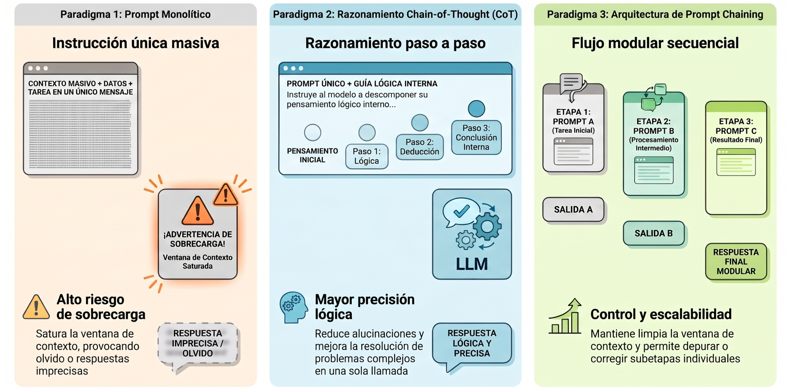
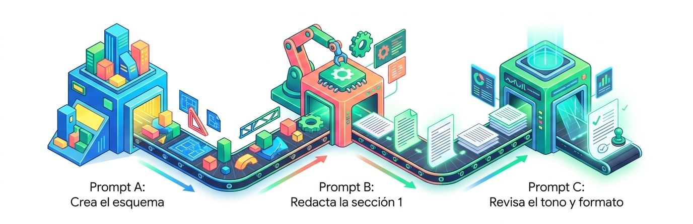

## **Encadenamiento**



El **encadenamiento de instrucciones** o ***prompt chaining*** es una técnica avanzada de la ingeniería de *prompts* y del desarrollo de aplicaciones con modelos de lenguaje grande (LLM) que consiste en **dividir una tarea compleja en una secuencia ordenada de subtareas más pequeñas, donde la salida generada por un *prompt* se utiliza como entrada directa o contexto para el siguiente *prompt***.

En lugar de intentar resolver un problema amplio mediante una única instrucción masiva y monolítica, el *prompt chaining* establece un **flujo de trabajo estructurado y modular**. Esta metodología permite guiar al modelo a través de etapas intermedias de procesamiento, facilitando un control preciso y una mayor calidad en los resultados finales.


### Descomposición de tareas 
**(*Divide and Conquer*)**

Uno de los principios nucleares de la ingeniería de *software* y de la interacción con modelos fundacionales es la **descomposición de tareas (*task decomposition*)** o el principio de **división del trabajo (*divide labor*)**. 

Cuando un usuario le solicita a un modelo de lenguaje que elabore un proyecto complejo en un solo turno (por ejemplo: *"investiga este tema, analiza los datos, extrae conclusiones, compáralas con la normativa y redacta un informe final de 10 páginas"*), el sistema suele presentar fallas predecibles:
*   **Saturación de la ventana de contexto:** A medida que la instrucción se satura de restricciones y requerimientos dispares, el modelo pierde capacidad de retención y olvida directrices esenciales.

*   **Deriva semántica y pérdida de foco:** El modelo tiende a generalizar de forma superficial, pasando por alto aspectos metodológicos o cometiendo errores lógicos acumulados.

*   **Falta de visibilidad y control de calidad:** Al recibir un resultado único de golpe, el usuario no puede auditar con facilidad en qué etapa exacta del razonamiento ocurrió un error.

El *prompt chaining* soluciona esto aislando cada fase operativa, garantizando que el modelo dedique toda su capacidad computacional y de atención a resolver un único objetivo a la vez antes de pasar a la siguiente etapa.

<center>
<figure>

<figcaption>**Prompt chaining**. Un prompt monolitico satura la ventana de contexto. La solución para proyectos masivos es dividir el trabajo: la salida de un prompt se convierte automáticamente en la entrada de datos del siguiente.</figcaption>
</figure>
</center>

### Flujo operativo

Un encadenamiento típico sigue una secuencia estructurada de pasos:

```
 ┌────────────────────────────────────────────────────────┐
 │ 1. Definición del objetivo global y metas intermedias  │
 └───────────────────────────┬────────────────────────────┘
                             │
                             ▼
 ┌────────────────────────────────────────────────────────┐
 │ PROMPT 1: Extracción o estructuración inicial          │
 │ (Entrada del usuario ──> Generación del resultado 1)   │
 └───────────────────────────┬────────────────────────────┘
                             │ (Salida 1 sirve de insumo)
                             ▼
 ┌────────────────────────────────────────────────────────┐
 │ PROMPT 2: Análisis, transformación o profundización    │
 │ (Resultado 1 + Contexto ──> Generación del resultado 2)│
 └───────────────────────────┬────────────────────────────┘
                             │ (Salida 2 sirve de insumo)
                             ▼
 ┌────────────────────────────────────────────────────────┐
 │ PROMPT 3: Síntesis, validación o formato final         │
 │ (Resultado 2 ──> Documento / Acción definitiva)        │
 └────────────────────────────────────────────────────────┘
```

1. **Definición del objetivo final:** Se identifica la meta global del sistema.
2. **Desglose en subobjetivos lógicos:** Se diseña la cantidad de pasos estrictamente necesarios (generalmente de 3 a 6 pasos para evitar dispersión).
3. **Ejecución del *Prompt* inicial:** Se procesa la primera tarea específica (por ejemplo, extraer datos brutos o generar un esquema temático).
4. **Alimentación secuencial (*Hand-off*):** La salida producida en el paso previo se inyecta programáticamente dentro de la plantilla del siguiente *prompt*.
5. **Revisión y consolidación:** Cada etapa intermedia puede ser filtrada, validada o ajustada antes de generar la respuesta final.


### *Prompt Chaining* vs. *Chain-of-Thought* (CoT)

Existe una confusión habitual entre ambas técnicas debido a la palabra *"Chain"* (cadena) en sus nombres, pero operan en niveles conceptuales y arquitectónicos completamente distintos:

| Criterio | *Chain-of-Thought* (CoT) | *Prompt Chaining* |
| :--- | :--- | :--- |
| **Naturaleza del proceso** | Es una técnica de **razonamiento interno dentro de un único *prompt***. | Es una técnica de **orquestación externa de múltiples *prompts* secuenciales**. |
| **Mecanismo de activación** | Se le pide al modelo que "piense paso a paso" (*"Let's think step by step"*) antes de entregar la respuesta en una sola llamada. | Se realizan **múltiples llamadas consecutivas** (a través de la interfaz o mediante llamadas a la API), donde cada llamada resuelve una subtarea distinta. |
| **Flujo de datos** | El modelo genera los pasos intermedios de pensamiento en el mismo bloque de texto de salida. | La salida del primer paso es capturada, transformada o filtrada por el sistema y luego inyectada como entrada al siguiente *prompt*. |
| **Control del usuario** | El usuario solo observa la explicación del razonamiento una vez completada. | El usuario o el código intermedio puede auditar, corregir o detener el proceso entre un paso y otro. |


### Ejemplos prácticos

#### Ejemplo A: Creación de un documento extenso o informe institucional
En lugar de solicitar al modelo: *"Escribe un manual completo sobre políticas de IA"*, se estructura una cadena de tres pasos:
*   **Paso 1 (*Prompt* de esquema):** *"Actúa como un especialista en políticas públicas. Genera un índice estructurado de 4 secciones principales con subsecciones para un informe sobre gobernanza de IA"*.

*   **Paso 2 (*Prompt* de desarrollo):** *"Tomando como base la 'Sección 1' del índice generado previamente, redacta el contenido detallado de 500 palabras manteniendo un tono formal y citando marcos normativos"*.

*   **Paso 3 (*Prompt* de revisión y estilo):** *"Revisa el texto redactado en el paso anterior. Corrige la sintaxis, elimina redundancias y adapta el vocabulario para un público directivo"*.

#### Ejemplo B: Clasificación y respuesta en atención ciudadana
Un sistema de atención ciudadana puede utilizar *prompt chaining* para tomar decisiones lógicas condicionales:
*   **Paso 1 (Clasificación de intención):** El primer *prompt* evalúa el mensaje del ciudadano y determina si la consulta corresponde a salud, subsidios habitacionales o trámites tributarios.

*   **Paso 2 (Generación de respuesta especializada):** Dependiendo de la categoría identificada en el paso 1, el sistema selecciona un *prompt* específico diseñado exclusivamente para ese trámite y redacta la respuesta pertinente.

#### Ejemplo C: Análisis de datos y evaluación crítica
En flujos de análisis de mercado o evaluación de proyectos, el encadenamiento permite realizar revisiones por capas:
1. Extraer los datos y cifras clave del texto original.
2. Analizar las tendencias y riesgos detectados en base a esas cifras.
3. Formular una matriz de recomendaciones o plan de acción final.


### Implementación técnica 
**En entornos de desarrollo (LangChain y LCEL)**

En la ingeniería de aplicaciones de inteligencia artificial moderna, marcos de trabajo como **LangChain** se diseñaron específicamente alrededor del concepto de encadenamiento (*chains*). 

A través del lenguaje de expresiones de LangChain (**LCEL**), los desarrolladores pueden componer cadenas secuenciales utilizando el operador de tubería (*pipe* `|`), conectando la salida de un componente directamente con la entrada del siguiente:

```python
# Ejemplo conceptual de Sequential Chain con LCEL
# El texto del primer paso alimenta al segundo paso de forma automática
cadena_resumen = prompt_extraccion | modelo_llm | StrOutputParser()
cadena_informe = prompt_redaccion | modelo_llm | StrOutputParser()

# Cadena compuesta donde la salida de una se convierte en la entrada de la otra
flujo_completo = (
    {"puntos_clave": cadena_resumen}
    | cadena_informe
)
```

Este enfoque modular ofrece una ventaja técnica crucial: permite **utilizar modelos distintos para tareas diferentes** dentro de la misma cadena. Por ejemplo, se puede emplear un modelo pequeño, rápido y económico para las etapas de extracción inicial o clasificación de intenciones, y reservar un modelo de gran escala y mayor costo computacional únicamente para la redacción final o la síntesis estratégica.


### Ventajas y limitaciones

#### Principales ventajas:
*   **Mayor precisión y control:** Permite evaluar y perfeccionar cada componente por separado, mejorando la coherencia global del sistema.

*   **Facilidad de depuración (*troubleshooting*):** Si la respuesta final contiene un error, es sencillo inspeccionar las salidas intermedias para saber exactamente qué *prompt* falló o generó una alucinación.

*   **Flexibilidad arquitectónica:** Permite incorporar validaciones intermedias por código tradicional (por ejemplo, comprobar si un JSON es válido) antes de que el siguiente *prompt* consuma los datos.

#### Limitaciones a considerar:
*   **Propagación y amplificación del error:** Si el primer *prompt* extrae un dato incorrecto o alucina, los pasos posteriores heredarán ese error y construirán sobre premisas defectuosas.

*   **Mayor latencia y consumo de recursos:** Al realizar múltiples llamadas sucesivas al modelo de lenguaje, el tiempo de respuesta total y el volumen acumulado de *tokens* aumentan en comparación con una consulta simple.

*   **Riesgo de deriva en cadenas excesivamente largas:** Si la cadena supera los 6 u 8 pasos sin una compresión o refresco explícito del contexto, el sistema puede experimentar desvíos respecto al objetivo inicial.

